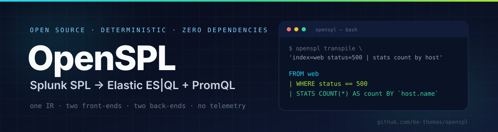
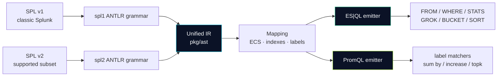

<div align="center">
  
  <br />
  <br />

  [](https://github.com/be-thomas/openspl/actions/workflows/ci.yml)
  [](https://go.dev)
  [](go.mod)
  [](LICENSE)
  [](#project-status)
  [](CONTRIBUTING.md)

  [](#supported-spl)
  [](#targets)
  [](#targets)

  <h1>OpenSPL — Splunk SPL to Elastic ES|QL &amp; PromQL Transpiler</h1>

  <p><strong>Translate Splunk SPL into Elastic ES|QL or Prometheus PromQL.</strong><br />
  Deterministic. Offline. No runtime services. Every warning points at the exact token.</p>
</div>

---

## One command. Two observability stacks.

```console
$ openspl transpile 'index=web status=500 | stats count by host'

FROM web
| WHERE status == 500
| STATS count = COUNT(*) BY `host.name`
```

```console
$ openspl transpile -t promql 'index=metrics | timechart span=5m count by host'

sum by (host) (increase(splunk_events_total{job="metrics"}[5m]))
```

| SPL (Splunk) | Elastic ES\|QL | Prometheus PromQL |
|---|---|---|
| `index=web status=500 \| stats count by host` | `FROM web`<br>`\| WHERE status == 500`<br>``\| STATS count = COUNT(*) BY `host.name` `` | *not a time-series query* |
| `index=metrics \| timechart span=5m count by host` | `FROM metrics`<br>``\| STATS count = COUNT(*) BY BUCKET(`@timestamp`, 5 minutes), `host.name` `` | `sum by (host) (increase(metric{job="metrics"}[5m]))` |
| `index=web host=web* \| stats count by host` | `FROM web`<br>``\| WHERE `host.name` LIKE "web*"``<br>``\| STATS count = COUNT(*) BY `host.name` `` | `sum by (host) (increase(splunk_events_total{host=~"^web.*$", job="web"}[5m]))` |
| `index=a OR index=b \| stats count` | `FROM a, b` | ⛔ refused: `promql-unsupported-filter`; matchers are conjunctions |

> **No black box.** OpenSPL is a compiler, not a model. The same query and mapping always produce the same output — byte for byte.

---

## Why OpenSPL?

| | Problem | OpenSPL's answer |
|---|---|---|
| 🔒 | Query languages are the real lock-in. Dashboards and alerts are years of encoded operational knowledge. | A free, auditable translator keeps that knowledge portable. |
| 🎲 | LLM-based converters hallucinate field names and silently change semantics. | A real parser + typed IR + golden tests. Unsupported syntax is a positioned error, never a guess. |
| 🏃 | Rewriting thousands of searches by hand is slow and error-prone. | One static binary. Script it, diff it, run it in CI. |
| ☁️ | Query text can contain hostnames, customer IDs, and secrets. | Runs entirely offline. No telemetry, no network calls, no accounts. |
| 🧪 | Migration needs evidence, not vibes. | Checked-in conformance suite, golden files, and a Docker harness that runs generated ES\|QL and PromQL against Elasticsearch and Prometheus; Splunk validation is optional. |

---

## Targets

| Target | Engine | Status | Best for |
|---|---|---|---|
| **`esql`** | Elasticsearch ES\|QL | ✅ Supported | Logs, search, stats, timecharts, regex extraction |
| **`promql`** | Prometheus | ✅ Supported | Counters and rate-style time-series aggregations |
| `kusto` | Azure Data Explorer | 💡 Proposed | Microsoft observability stacks |

SPL2 is an **input dialect**, not a target. Pass `--spl-version 2` to parse the
supported subset (`from`, `where`, `stats`) and emit either target above.

### Fidelity contract

| Tier | Meaning | Example |
|---|---|---|
| ✅ **Exact** | Direct, semantics-preserving mapping. | `stats count by host` → ``STATS count = COUNT(*) BY `host.name` `` |
| ⚠️ **Approximate** | Emitted with a warning that names the risk. | Free text → `MATCH(message, …)`; `rex` → `GROK` |
| ⛔ **Refused** | No faithful mapping; compilation stops. | `stats avg(bytes)` → PromQL |

Every diagnostic is stable and positioned:

```text
1:8: warning[fulltext-approximation]: free-text term "error" is translated to MATCH on "message"; verify analyzer and tokenization
1:19: error[promql-unsupported-agg]: aggregation "avg" has no faithful PromQL mapping; only count is supported because it maps to a counter increase
```

---

## Install

```bash
# Build from source (Go 1.24+)
git clone https://github.com/be-thomas/openspl.git
cd openspl
go build -o openspl ./cmd/openspl

# Or install directly
go install github.com/be-thomas/openspl/cmd/openspl@latest
```

<details>
<summary><strong>Verify the build</strong></summary>

```console
$ ./openspl version
openspl 0.1.0-dev (commit none, built unknown)

$ ./openspl targets
TARGET   ENGINE                STATUS
esql     Elastic ES|QL         supported
promql   Prometheus PromQL     supported (time-series aggregations only)
```

</details>

---

## 60-second quickstart

```bash
# 1. Static search to ES|QL
openspl transpile 'index=auth sourcetype=sshd "Failed password" | stats count by src_ip'

# 2. Time series to PromQL
openspl transpile -t promql 'index=metrics | timechart span=1m count by host'

# 3. Read long searches from files or stdin
openspl transpile -f savedsearch.spl --mapping configs/ecs.json
cat savedsearch.spl | openspl transpile -t promql

# 4. Machine-readable output for migration tooling
openspl transpile --json 'index=web | stats count' | jq .

# 5. Fail CI on any approximation
openspl transpile --strict -f savedsearch.spl
```

### CLI at a glance

| Flag | Purpose | Default |
|---|---|---|
| `-t, --target esql\|promql` | Choose the output language | `esql` |
| `--mapping file.json` | Field, index, and label dictionary | built-in ECS map |
| `--index name` | Override the index selected in the query | from SPL |
| `--metric name` | PromQL metric name | `splunk_events_total` |
| `--span duration` | PromQL range window or timechart fallback | `5m` |
| `--spl-version 1\|2` | Input dialect: classic SPL or the SPL2 subset | `1` |
| `-f, --file file` | Read the query from a file (`-` = stdin) | stdin |
| `--json` | Emit JSON with `ok`, `query`, and diagnostics | off |
| `--strict` | Treat warnings as errors | off |

### Exit codes

| Code | Meaning |
|---|---|
| `0` | Translation succeeded |
| `1` | Parse or semantic error (or warning with `--strict`) |
| `2` | Usage, flag, mapping, or input error |

---

## Supported SPL

| Command | ES\|QL | PromQL | Notes |
|---|---|---|---|
| `search` / implicit search | ✅ | ⚠️ | Free text becomes `MATCH`; PromQL needs explicit fields |
| `where` | ✅ | ⚠️ | Full expression pushdown to `WHERE` |
| `stats` | ✅ | ⚠️ | `count`, `dc`, `sum`, `avg`, `min`, `max`; PromQL: `count` only |
| `timechart` | ✅ | ✅ | Time bucket → `BUCKET` or `increase(...[span])` |
| `eval` | ✅ | ⛔ | Arithmetic, comparisons, common functions |
| `rex` | ⚠️ | ⛔ | Regex → Grok; always warns |
| `table` | ✅ | ⛔ | `KEEP` |
| `fields` | ✅ | ⛔ | `KEEP` / `DROP` |
| `sort` | ✅ | ⚠️ | `SORT`; PromQL → `sort`, `sort_desc`, `topk`, `bottomk` |
| `head` | ✅ | ⚠️ | `LIMIT`; PromQL only after a sort |
| `bin` | ⚠️ | ⛔ | Derived `BUCKET` column |

**Recognized but not implemented** — `join`, `lookup`, `transaction`, `eventstats`, `streamstats`, `dedup`, `top`, `rare`, `chart`, `append`, `multisearch`, subsearches, and more. These return `unsupported-command` with a precise position rather than a misleading parse.

### SPL2 subset

With `--spl-version 2`, a pipeline must start at `from` and may continue with
`where` and `stats`:

```console
$ openspl transpile --spl-version 2 'from main | where status=500 | stats count() AS count BY host'

FROM main
| WHERE status == 500
| STATS count = COUNT(*) BY `host.name`
```

SPL2 semantics are not classic SPL: a bare word is a field reference on both
sides of a comparison, and conditions need an explicit `AND`. Namespaced
datasets (`datamodel:…`, `lookup:…`) and every command outside the subset are
refused with a positioned diagnostic.

Full matrix → [docs/COMPATIBILITY.md](docs/COMPATIBILITY.md)

## Conformance report

Measured over the checked-in query corpus: 2,812 queries in total, made up of
549 documented SPL1 examples, 2,171 detection searches from Splunk
`security_content`, and 92 documented SPL2 examples. The IR is the parsed
`*ast.Pipeline`; ES\|QL (the SQL-style back-end) and PromQL are the two
back-ends, so there is no separate SQL target. `SPL→x` is the share of every
query in the row; `IR→x` is the share of the queries that parsed. All figures
use the compiled-in default mapping with no per-query index, metric, or span
override.

| Collection | Queries | → IR | SPL→IR | → ES\|QL | SPL→ES\|QL | IR→ES\|QL | → PromQL | SPL→PromQL | IR→PromQL |
|---|---|---|---|---|---|---|---|---|---|
| `spl1` | 549 | 69 | 12.6% | 59 | 10.7% | 85.5% | 6 | 1.1% | 8.7% |
| `spl1-detections` | 2,171 | 15 | 0.7% | 6 | 0.3% | 40.0% | 0 | 0.0% | 0.0% |
| `spl2` | 92 | 0 | 0.0% | 0 | 0.0% | — | 0 | 0.0% | — |
| **Total** | **2,812** | **84** | **3.0%** | **65** | **2.3%** | **77.4%** | **6** | **0.2%** | **7.1%** |

84 of 2,812 queries (3.0%) parse to the IR, 65 (2.3%) compile end-to-end to
ES\|QL, and 6 (0.2%) to PromQL. The low SPL1 detection figure is parser
coverage, not emitter coverage — `tstats` alone accounts for 1,022 of the
refusals. Where a query does parse, ES\|QL emits for 77.4% and PromQL for 7.1%.

The 78 PromQL refusals are deliberate. The largest single cause is
`promql-no-aggregation` (21): the pipeline does not end in an aggregation, so
it produces rows rather than a time series. Another 33 use a stage with no
PromQL form — `eval` 17, `table` 9, `rex` 5, `fields` 2 — and 16 combine or
name an aggregation PromQL cannot express. The remaining 8 are refused over
row filters, free-text terms, or ordering.

Regenerate with `make corpus-report`; it prints this table from the corpus.

---

## Architecture



| Layer | Package | Responsibility |
|---|---|---|
| Front-end | `pkg/parser/spl1` | ANTLR grammar and generated parser for classic SPL; lowers into IR. |
| Front-end | `pkg/parser/spl2` | ANTLR grammar for the SPL2 subset (`from`, `where`, `stats`). |
| Generated | `pkg/parser/*/gen` | Committed ANTLR output; edit the `.g4`, never these files. |
| IR | `pkg/ast` | One typed pipeline shared by every language. |
| Mapping | `pkg/mapping` | Splunk field → ECS field, index patterns, Prometheus labels. |
| Back-end | `pkg/emitter/esql` | IR → ES\|QL. |
| Back-end | `pkg/emitter/promql` | IR → PromQL, with semantic refusal. |
| Driver | `pkg/compiler` | Parse, validate, emit, collect diagnostics. |
| CLI | `cmd/openspl` | Flags, stdin, JSON, exit codes. |

Read more → [docs/ARCHITECTURE.md](docs/ARCHITECTURE.md) · [ADRs](docs/adr/)

---

## Mapping: Splunk fields → ECS → Prometheus

| Splunk | ECS / ES\|QL | Prometheus label |
|---|---|---|
| `_time` | `@timestamp` | `timestamp` |
| `_raw` | `message` | `message` |
| `host` | `host.name` | `host` |
| `source` | `log.file.path` | `file` |
| `sourcetype` | `event.dataset` | `sourcetype` |
| `index` | index pattern (`FROM …`) | `job` |

```json
{
  "default_index": "logs-*",
  "time_field": "@timestamp",
  "text_field": "message",
  "fields": { "host": "host.name", "source": "log.file.path" },
  "indexes": { "web": "logs-web-*" },
  "prometheus": {
    "metric": "splunk_events_total",
    "function": "increase",
    "index_label": "job",
    "labels": { "host.name": "host" }
  }
}
```

Unknown keys are rejected. Mapping typos fail loudly instead of producing quietly wrong queries.
Full reference → [docs/MAPPING.md](docs/MAPPING.md)

---

## Project status

| Milestone | State |
|---|---|
| Unified IR, SPL v1 parser, ES\|QL emitter | ✅ v0.1 |
| PromQL emitter with semantic guardrails | ✅ v0.1 |
| Golden conformance suite + unit tests + CI | ✅ v0.1 |
| Docker validation (Elasticsearch and Prometheus; Splunk optional) | 🧪 Harness included |
| SPL v2 front-end | 🗺️ Planned |
| `join`, `lookup`, `eventstats`, subsearches | 🗺️ Planned |
| Dashboard and saved-search batch migration | 💡 Proposed |

> **Alpha software.** The API and diagnostic codes may change before v1.0. Do not migrate production alerts without validating results against your own data.

---

## FAQ

<details>
<summary><strong>How do I convert Splunk SPL to Elasticsearch ES|QL?</strong></summary>

Run `openspl transpile '<your SPL>'`. The default target is ES|QL. Use `--mapping` to point Splunk field names at your ECS schema and `--index` to override the index pattern. See the [quickstart](#60-second-quickstart).
</details>

<details>
<summary><strong>Can I convert Splunk searches to PromQL?</strong></summary>

Only time-series aggregations. PromQL has no concept of raw log rows, so OpenSPL accepts `stats`/`timechart` with a single `count` aggregation and refuses everything else with a positioned error. This is deliberate: a silent semantic change is worse than a failed compile.
</details>

<details>
<summary><strong>Does OpenSPL call an LLM or send my queries anywhere?</strong></summary>

No. Queries are processed in memory, and the process makes no network calls. The binary links one third-party module, the ANTLR Go parser runtime; there are no services, plugins, or telemetry. This matters when searches contain internal hostnames, customer identifiers, or credentials.
</details>

<details>
<summary><strong>How is this different from LLM-based SPL converters?</strong></summary>

OpenSPL is deterministic: the same input and mapping produce the same bytes. Every construct is parsed, typed, and mapped explicitly. Unsupported constructs are refused with a source position. LLM converters are useful for drafts, but they cannot give you a reproducible migration diff.
</details>

<details>
<summary><strong>Does it support SPL2?</strong></summary>

Partially: `--spl-version 2` accepts `from`, `where`, and `stats`, emitting the same targets as classic SPL. SPL2 lives in its own ANTLR grammar and front-end so its semantics do not leak into classic SPL. Every other SPL2 command is recognized and refused with a position; see [docs/COMPATIBILITY.md](docs/COMPATIBILITY.md).
</details>

<details>
<summary><strong>Can I validate translations against real engines?</strong></summary>

Yes. [`conformance/engines`](conformance/engines/) contains a Docker Compose harness for Splunk, Elasticsearch, and Prometheus plus the live-engine cases. See [conformance/engines/README.md](conformance/engines/README.md).
</details>

<details>
<summary><strong>Is OpenSPL production-ready?</strong></summary>

It is alpha. The emitter is deliberately conservative: exact where possible, warned where approximate, refused where not faithful. Use `--strict` to make warnings fail CI.
</details>

---

## Contributing

Conformance cases, the metadata schema, and the live-engine harness are
documented in [CONFORMANCE.md](CONFORMANCE.md).

| Step | Command |
|---|---|
| 1. Fork and clone | `gh repo fork be-thomas/openspl --clone` |
| 2. Install hooks | `make hooks` |
| 3. Build and test | `make check` |
| 4. Add a conformance case | `conformance/cases/<area>/<name>.spl` + golden file |
| 5. Open a PR | Describe the semantic mapping and its risks |

- **Commits:** no AI attribution, tool signatures, or co-author trailers. Enforced by `.githooks/commit-msg`, `scripts/check-commit-message.sh`, and CI.
- **New back-ends:** add an emitter package; never parse SPL there.
- **New commands:** add IR nodes and both emitters, or return an explicit "unsupported" diagnostic.
- **Tests:** golden outputs are the contract. Approximations must carry warning codes.

Read [CONTRIBUTING.md](CONTRIBUTING.md) · [SECURITY.md](SECURITY.md) · [CHANGELOG.md](CHANGELOG.md)

---

## License

Apache-2.0. Use it, embed it, fork it, sell services around it. See [LICENSE](LICENSE).

<div align="center">
  <sub><strong>Topics:</strong> Splunk · SPL · SPL2 · Elasticsearch · ES|QL · PromQL · Prometheus · ECS · observability · query migration · log analytics · SRE · OpenTelemetry</sub>
</div>
